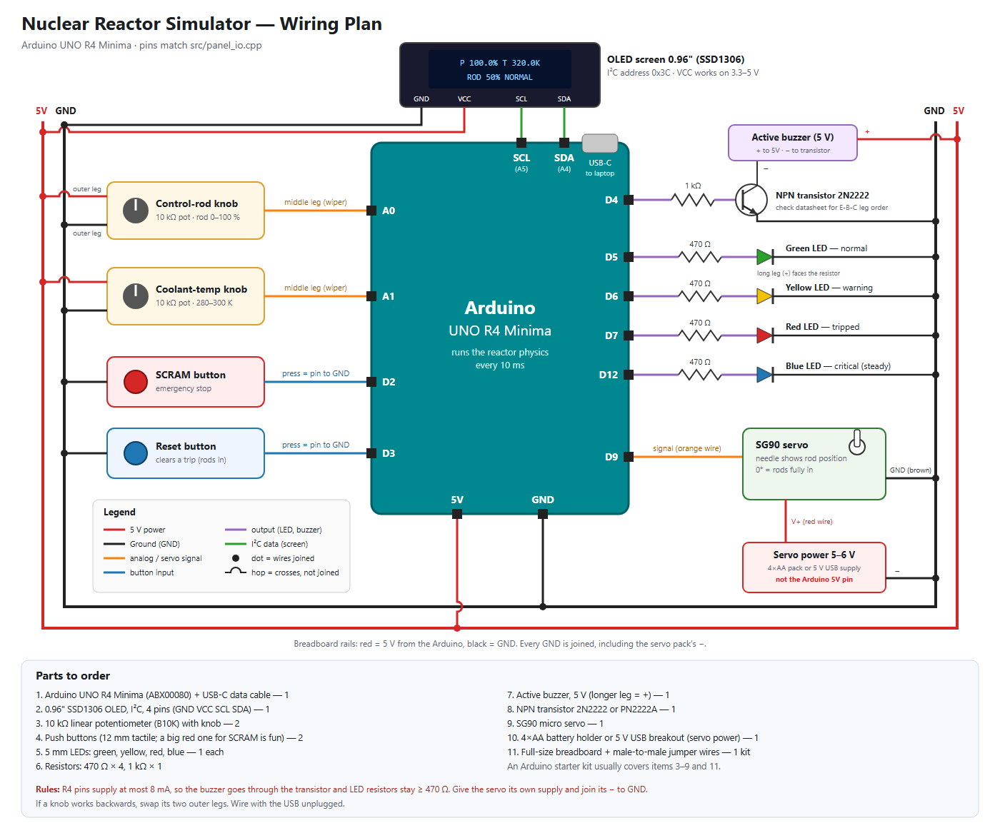

# Nuclear Reactor Simulator

ENGR 217 project: a point-kinetics reactor simulator running in real time on an
Arduino UNO R4 Minima. It has a hardware control panel (control-rod pot,
coolant pot, SCRAM and reset buttons, status LEDs, buzzer, rod-position servo
and an SSD1306 OLED). The same physics library builds on the desktop for unit
tests and for validation against a SciPy reference.

Model: six-group point kinetics with Keepin U-235 data (Λ = 1e-4 s,
β = 0.006502), solved with a closed-form backward-Euler step (h = 10 ms). There
is an S-curve control rod worth $2.2 and a safety bank worth $4, plus a
lumped fuel-temperature model with negative feedback. A protection system
handles trips. See [docs/PLAN.md](docs/PLAN.md) and
[docs/CODE-GUIDE.html](docs/CODE-GUIDE.html).

## Layout

| Path | Contents |
|---|---|
| `lib/reactor/src/` | Physics library (plain C++, `float`, no Arduino deps) |
| `tests/` | doctest unit tests (T1–T18) |
| `desktop/sim_cli.cpp` | Command-line scenarios, writes CSV to stdout |
| `tools/` | SciPy reference, comparison plots, serial capture |
| `src/` | Arduino firmware (main loop, panel I/O, OLED) |
| `figures/` | Validation plots from `tools/compare.py` |
| `results/` | CSV output (git-ignored) |

## Desktop build and tests

Needs a C++17 compiler, CMake ≥ 3.16 and Ninja.

```powershell
cmake -S . -B build -G Ninja -DCMAKE_BUILD_TYPE=Release
cmake --build build
.\build\unit_tests.exe          # or: ctest --test-dir build
```

## Simulation CLI

```text
sim_cli --scenario {hold,step,ramp,scram,rodpull,startup}
        [--rho-dollars X] [--dt S] [--method implicit|explicit] [--t-end S]
```

- `hold`, `step` and `ramp` use kinetics only; `ramp` reaches the target over 10 s.
- `rodpull` uses the plant (rod plus temperature feedback) with no protection.
- `scram` and `startup` run the full `Reactor`, protection included.

The output is CSV at 0.1 s intervals with the columns
`t,rho,n,T,period,sur,rod,trip` (`startup` adds `inv_m`). Units: `rho` in
dollars, `n` normalized (1 = 100 %), `T` in K, `period` in s, `sur` in
decades/min, `rod` from 0 (inserted) to 1 (withdrawn), `trip` a bit mask.

```powershell
.\build\sim_cli.exe --scenario rodpull --rho-dollars 0.2 > results\rodpull.csv
```

## Python tools

```powershell
python -m venv .venv
.\.venv\Scripts\pip install -r tools\requirements.txt
.\.venv\Scripts\python tools\reference.py --inhour 0.1    # stable period, +$0.1
.\.venv\Scripts\python tools\compare.py                   # writes figures\*.png
.\.venv\Scripts\python tools\capture_serial.py --port COM5 --seconds 120
```

## Firmware

Build and upload with PlatformIO (VS Code extension or CLI):

```powershell
pio run                 # compile
pio run -t upload       # flash the UNO R4 Minima
pio device monitor      # 115200 baud
```

On a network that intercepts TLS, install `pip-system-certs` into the same
Python as PlatformIO so it trusts the Windows certificate store.

### Wiring



Full diagram with parts list: [docs/wiring.svg](docs/wiring.svg).

| Pin | Part | Notes |
|---|---|---|
| A0 | Rod pot | Rod demand 0–1 |
| A1 | Coolant pot | Coolant temperature 280–300 K (290 K at mid-scale) |
| D2 | SCRAM button | To GND, interrupt |
| D3 | Reset button | To GND, debounced 30 ms |
| D4 | Buzzer | Sounds on a trip until reset; short chirp on a warning |
| D5 | Green LED | Normal |
| D6 | Yellow LED | Warning (power > 105 %, T > 325 K or period < 30 s) |
| D7 | Red LED | Tripped |
| D12 | Blue LED | Critical (steady state) |
| D9 | Servo | Rod position |
| SDA/SCL | SSD1306 OLED | I²C address 0x3C |

R4 pins supply at most 8 mA: use 470 Ω on each LED and drive the buzzer
through an NPN transistor (1 kΩ base resistor). Power the servo from its own
5 V supply and connect that supply's ground to the Arduino's.

### Serial commands

| Command | Action |
|---|---|
| `m p` / `m c` / `m t` | Output mode: Serial Plotter / CSV / Teleplot |
| `r <dollars>` | Test mode: replace rod reactivity with a fixed value |
| `x` | Leave test mode |
| `s` | SCRAM |
| `z` | Reset |
| `b` | Benchmark one kinetics step |

Test mode (`r`) is a physics-test aid. It bypasses the high-power,
high-temperature and short-period trips, but not prompt-critical, fault or
manual SCRAM. It ends on any trip.

### Protection

Trips latch and insert all rods. They are high power (> 120 %), high
temperature (> 330 K), short period (< 10 s), prompt critical (ρ ≥ $1),
numerical fault, and manual SCRAM. A reset clears the latch only when no trip
condition remains and the rods are fully in. That includes the rod pot, so
turn it fully down before you press reset.

Trip bits: 1 manual, 2 high power, 4 high temperature, 8 short period,
16 prompt critical, 32 fault.

## License

MIT. See [LICENSE](LICENSE).
